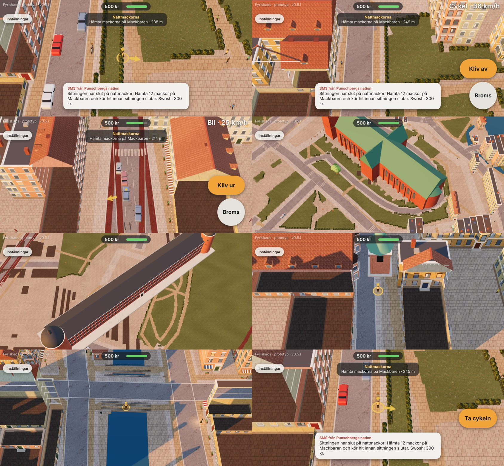
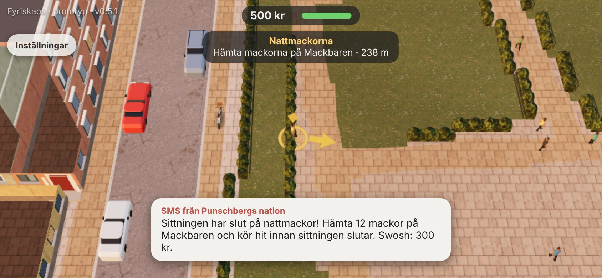
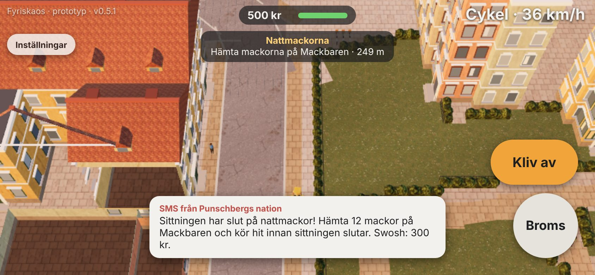
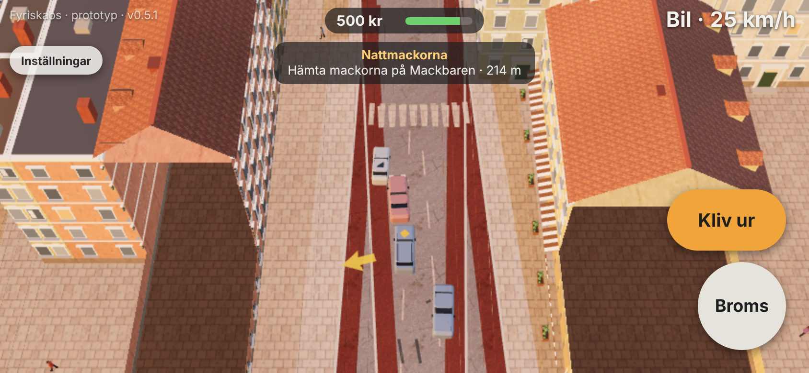
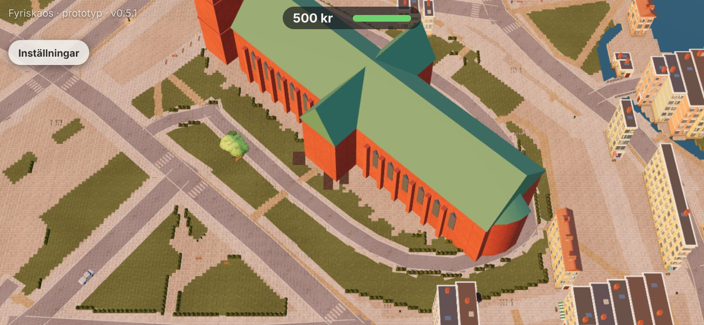
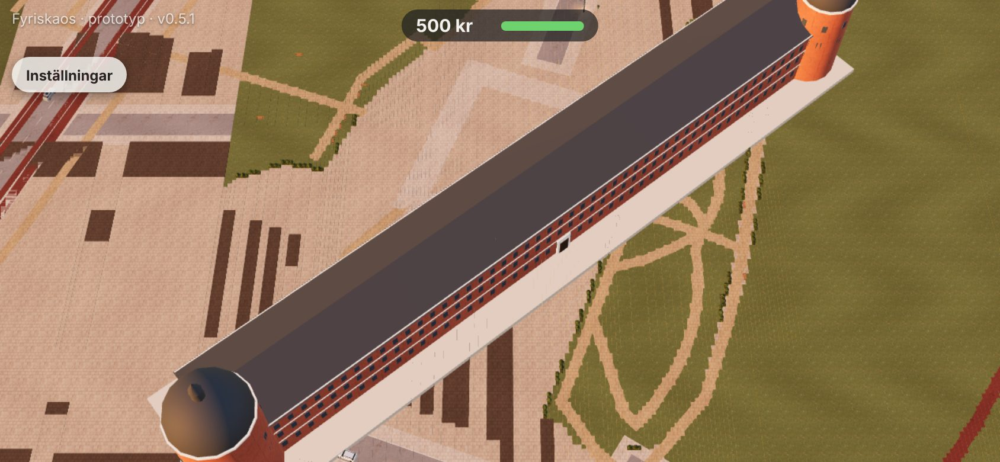
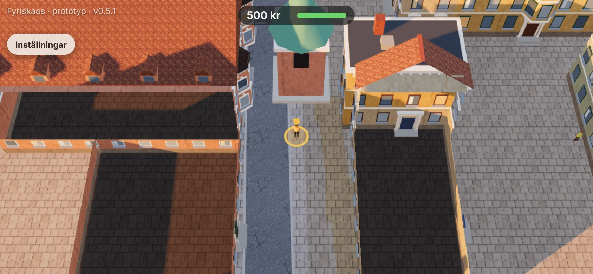
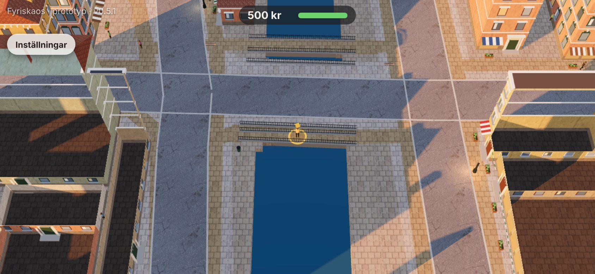
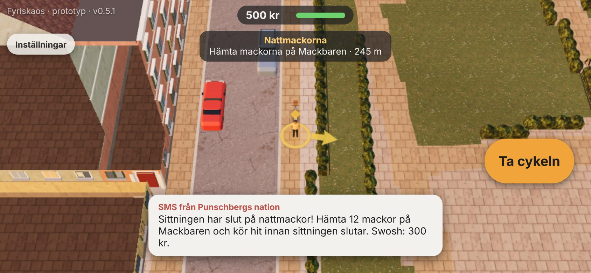
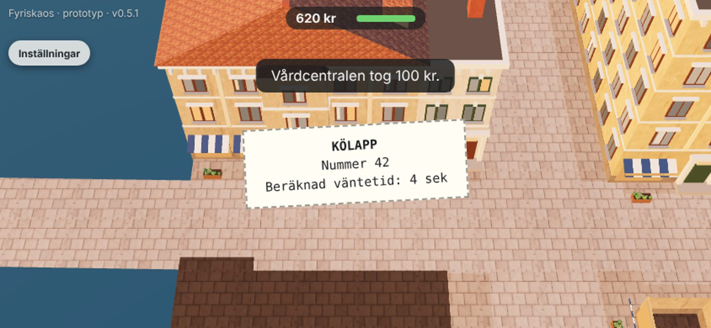

# Centrum i Uppsala (F-005) – skärmdumpar och mätningar

Tagna 2026-11-19 i en molnwebbläsare (Chromium) i mobilstorlek liggande (844 × 390, 2× upplösning). Spelet: https://badbagel47.github.io/fyriskaos/

| Läge | Bild |
| --- | --- |
| Gå vid starten: uppdraget, pilen mot målet och markeringen över spelaren |  |
| Cykla |  |
| Köra i fart: husen på kamerasidan är nerklippta till bottenvåningen, kameran ser framåt |  |
| Domkyrkan (översikt från högre höjd) |  |
| Slottet med sina runda torn (översikt) |  |
| Gunillaklockan (översikt) |  |
| Fyrisån med en bro (översikt) |  |
| SMS med första uppdraget |  |
| Kölappen på vårdcentralen |  |

Översiktsbilderna är tagna med en kamera högre upp än i spelet, för att landmärkena ska få plats; i spelet syns de när man är en bit söder om dem.

## Prestanda medan man kör i 90 km/h genom centrum

Bilen kör 875 m rakt genom centrum, fram och tillbaka, i 40 s. Måttet är spelets arbetstid per bild med strypt processor. Molnet har inget grafikkort och räknar fram grafiken i processorn, så siffrorna är högre än på en telefon med grafikkort; fps-mätaren under *Inställningar* visar hur det går på telefonen.

| Strypning | Kvalitet | Ritning, median | Ritning, 9 av 10 under | Anrop | Trianglar |
| --- | --- | --- | --- | --- | --- |
| ingen | Medel | 3,7 ms | 5,5 ms | 111 | 236 000 |
| 4× | Medel | 18,4 ms | 27,7 ms | 127 | 254 000 |
| 4× | Hög | 16,2 ms | 24,8 ms | 112 | 233 000 |

- Staden byggs i bitar om 64 m runt kameran medan man kör. En bit tar cirka 20 ms att bygga utan strypning; bygget får cirka 4 ms per bild vid 60 bilder per sekund. I molnet, där varje bild är långsam, får bygget mer tid per bild (därför redovisas det separat).
- Budgeten är 16,7 ms per bild (60 bilder per sekund). Med 4× strypning ligger ritningen precis vid gränsen.
- Start till första bild på långsamt nät (1,6 Mbit/s, 150 ms fördröjning) med 4× strypning: cirka 9 s; cirka 420 kB före första bilden. Kartan är cirka 260 kB komprimerad. Se F-051.
