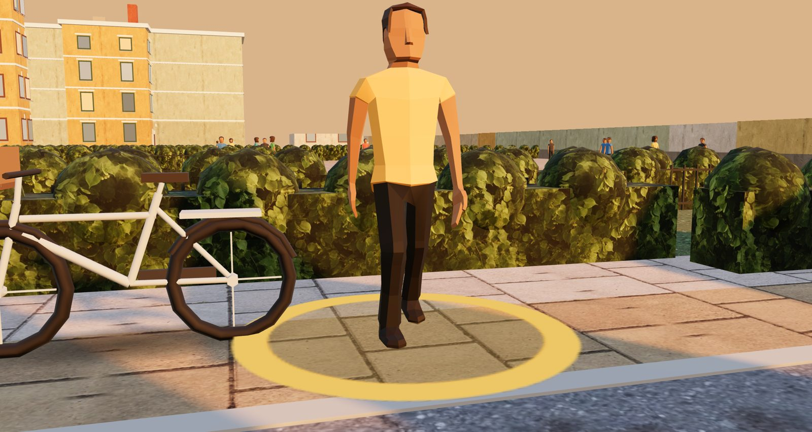
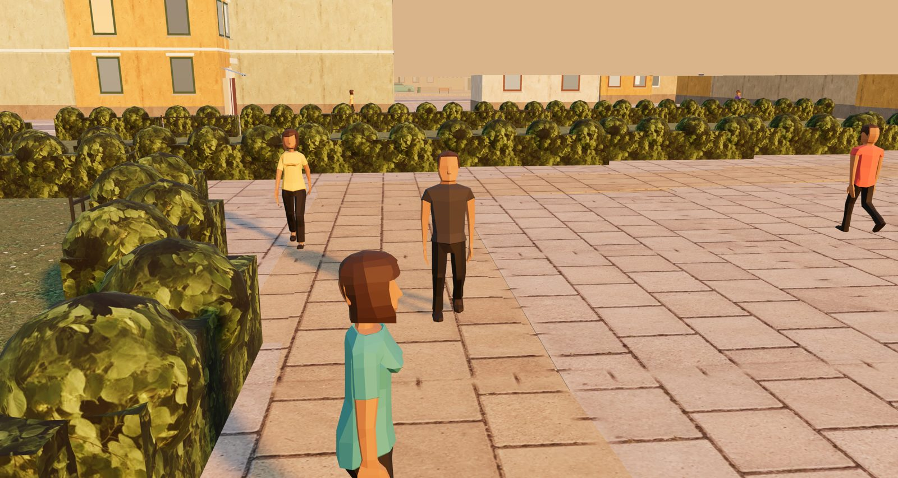
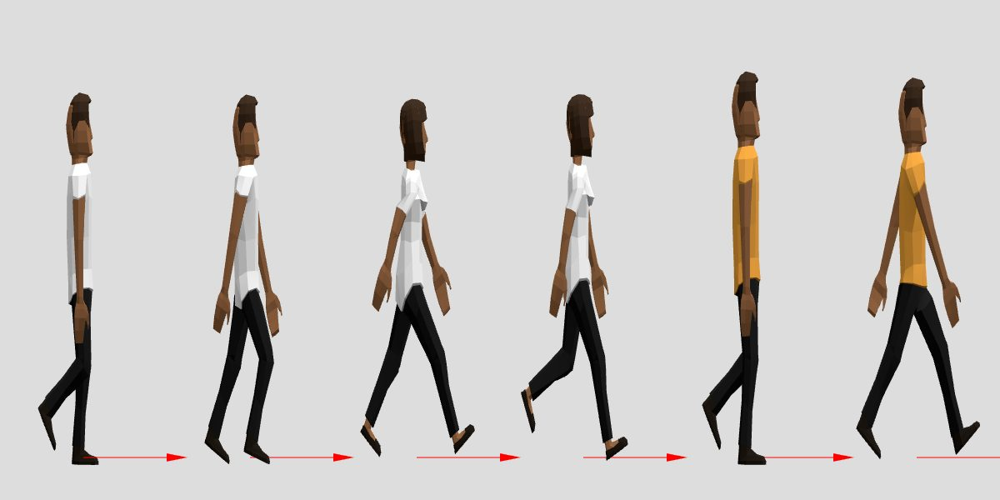

# Gång och riktning (B-058) – skärmdumpar och mätning

Tagna 2026-11-19 i en molnwebbläsare (Chromium). Kameran är flyttad ned framför figurerna för att ansiktena ska synas; i spelet ser man dem snett ovanifrån.

| Vad | Bild |
| --- | --- |
| Spelaren springer mot kameran: ansiktet åt rörelseriktningen, armar och ben i steg |  |
| Fotgängare på trottoaren: de två i mitten går mot kameran, mannen till höger går åt höger |  |
| Gångcykeln från sidan (man, kvinna, spelaren; olika lägen i steget), pilen visar framåt |  |

**Orsak:** figurerna i Quaternius-paketet tittar åt +z. Omvandlingen vred dem ett kvarts varv åt fel håll, så de tittade åt −x medan spelet räknar +x som framåt: alla gick baklänges. Spelaren såg ryckig ut för att den bytte mellan tre fasta poser (stå, gå, spring) flera gånger i sekunden.

**Prestanda:** gång bland 34 fotgängare med 4× strypt processor: 12–14 ms per bild i median före och efter ändringen (inom mätbruset). Fotgängarna ritas nu med 4 i stället för 8 ritanrop; armar och ben räknas i grafikkortet.
