# Ljuseffekter på kvällen (F-059–F-062) – före och efter, prestanda

Tagna 2026-11-20 i en molnwebbläsare (Chromium, utan grafikkort), mobil liggande 844 × 390 med 2× upplösning, kvällsläget (`?kvall`) på Hög om inget annat står. Bilderna "nära" är tagna med en låg kamera som bara används för kontroll; spelet ses alltid snett ovanifrån.

| Vad | Före | Efter |
| --- | --- | --- |
| Gata med lyktor | 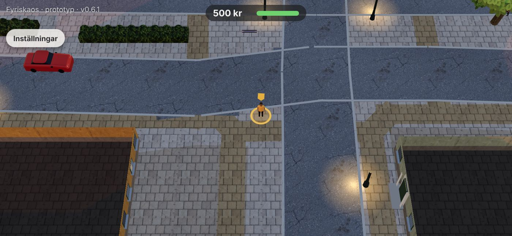 | 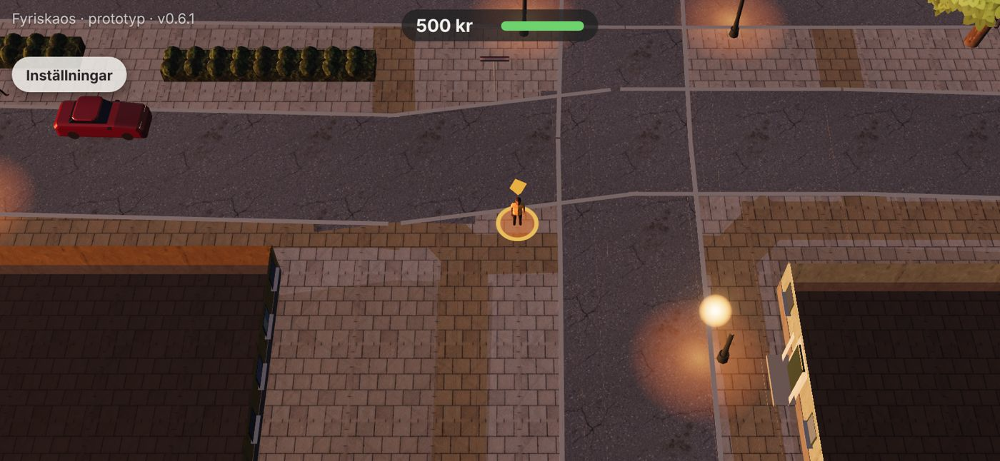 |
| Samma gata på Medel (glöd i halv upplösning) | | 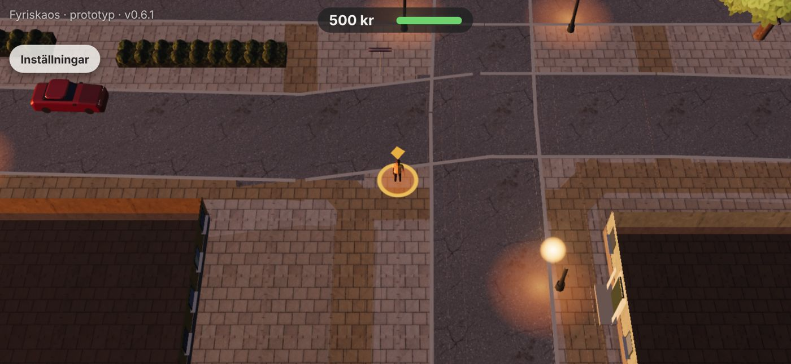 |
| Bil på en bro över Fyrisån | 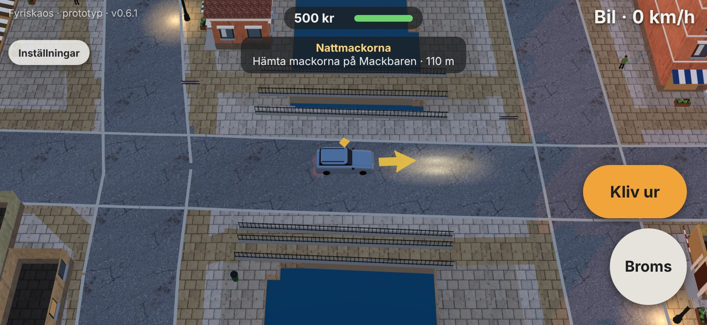 | 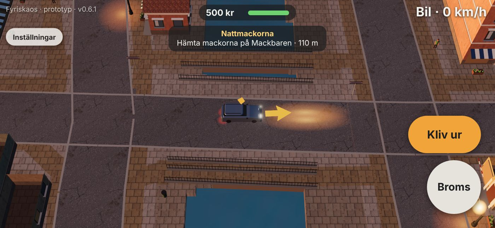 |
| Bilen på nära håll, lyktorna längs ån | 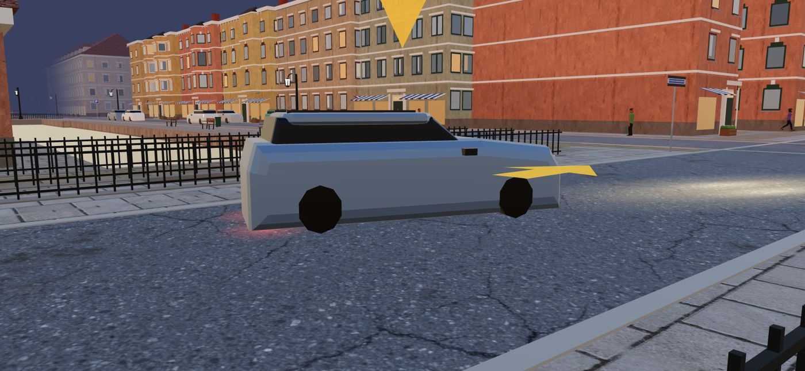 | 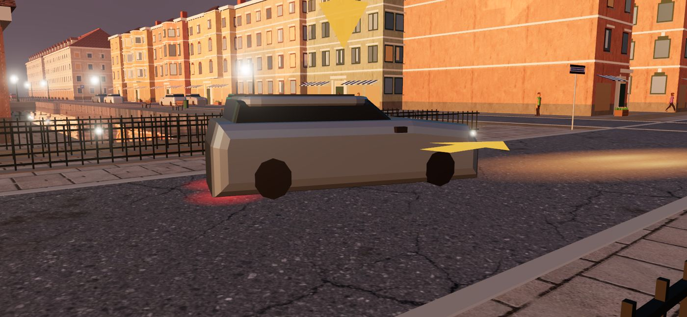 |
| Fyrisån vid bron (spegling på Hög) | 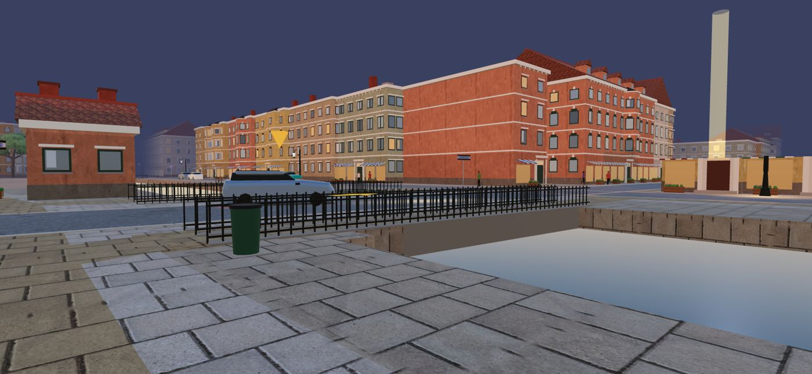 | 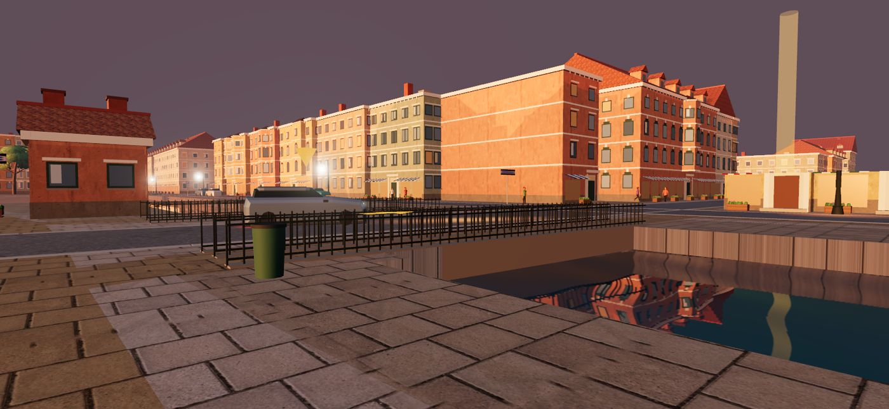 |
| Samma gata på dagen | 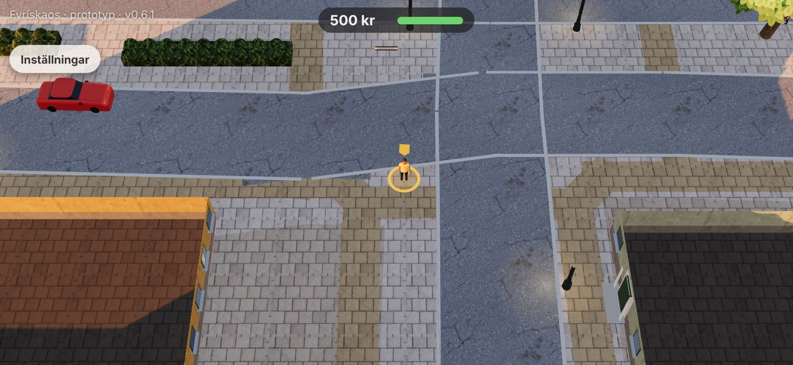 | 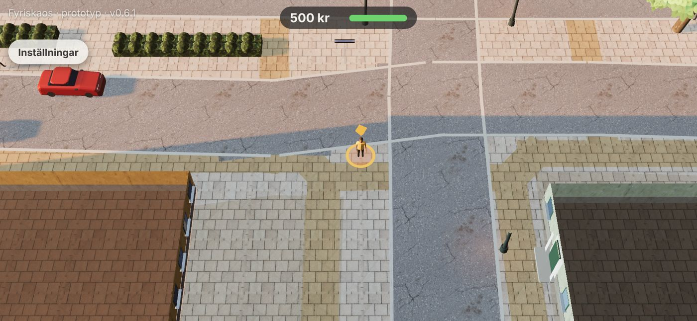 |

## Prestanda

Bil i 90 km/h österut över bron vid Fyrisån och genom centrum, kvällsläget, 45 s per nivå. "Bildtid" är spelets egen tid per bild på processorn (simulering och ritning, utan stadsbygget), median / 90:e percentilen, i ms. Molnet saknar grafikkort, så grafikkortets del (glöd, spegling) kan inte mätas här; "bilder/s i molnet" visar programvarurenderingens relativa belastning.

| Nivå | 4× strypt, före | 4× strypt, efter | 1×, före | 1×, efter | Bilder/s i molnet, före → efter |
| --- | --- | --- | --- | --- | --- |
| Låg | 10,8 / 15,5 | 11,6 / 18,5 | 2,5 / 3,8 | 2,6 / 3,3 | 3,6 → 3,5 |
| Medel | 13,0 / 18,8 | 15,1 / 21,0 | 2,9 / 4,6 | 3,2 / 4,3 | 1,6 → 1,4 |
| Hög | 12,7 / 17,0 | 16,8 / 34,1 | 2,9 / 3,9 | 3,7 / 12,6 | 0,8 → 0,8 |

- **Medel** håller budgeten (under 17 ms per bild med 4× strypning) i median. Den 90:e percentilen låg över budgeten redan före ändringen.
- **Hög** med ån i bild: 24,8 ms i median med 4× strypning (resten av körningen 13,0 ms), eftersom speglingen ritar staden en gång till. Den ritas därför om bara var annan bild. Hög räknas inte in i budgeten.
- En stopp på cirka 0,7 s första gången ån syntes på Hög är borttagen: speglingen och dess himmel förbereds nu vid starten.
