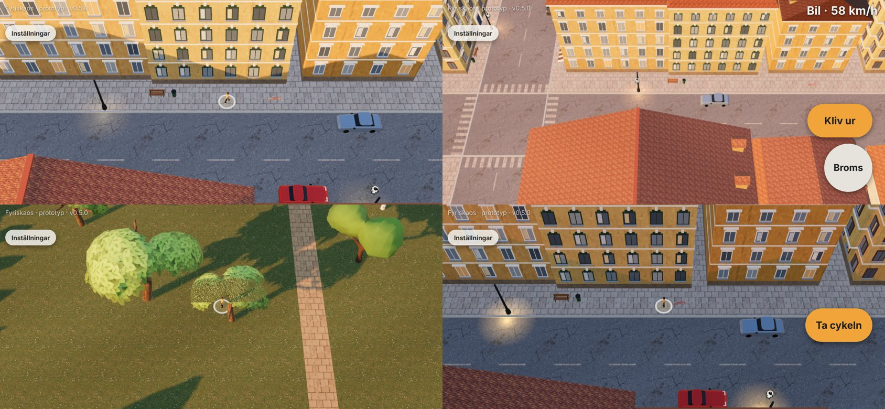
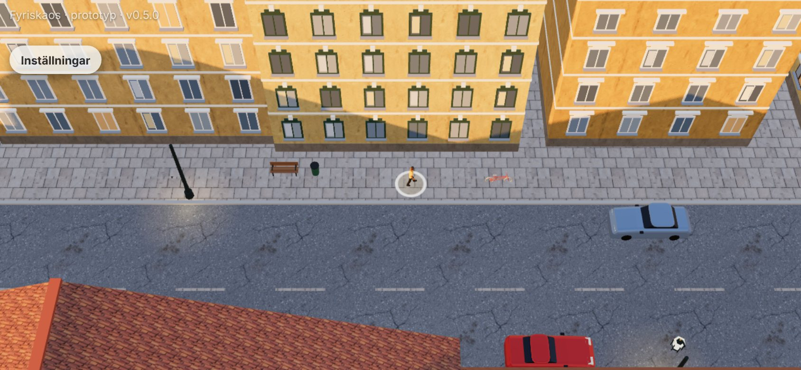
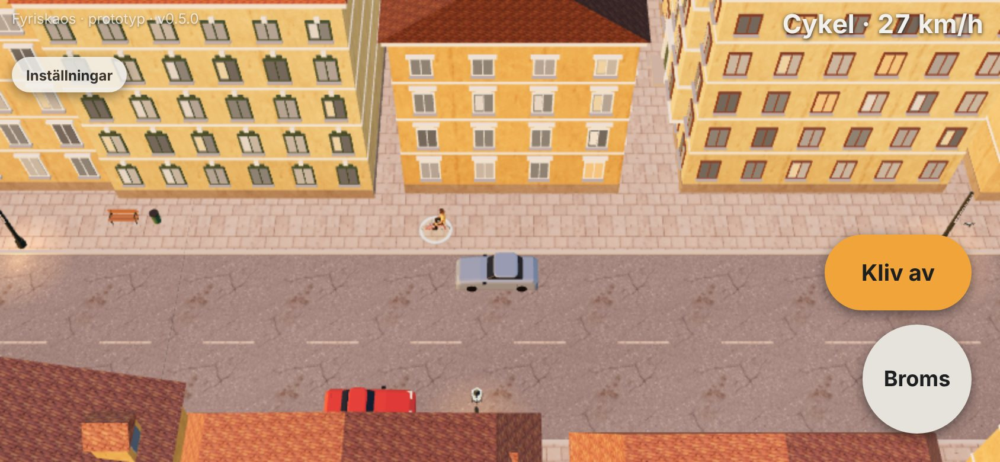
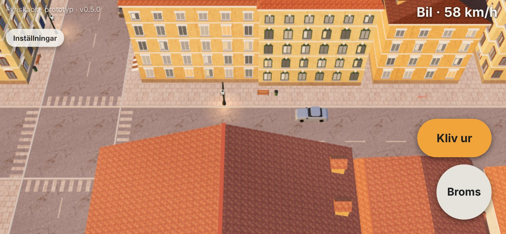
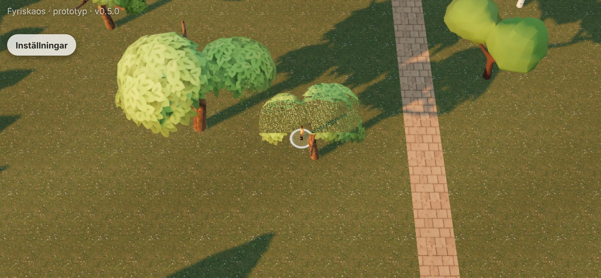
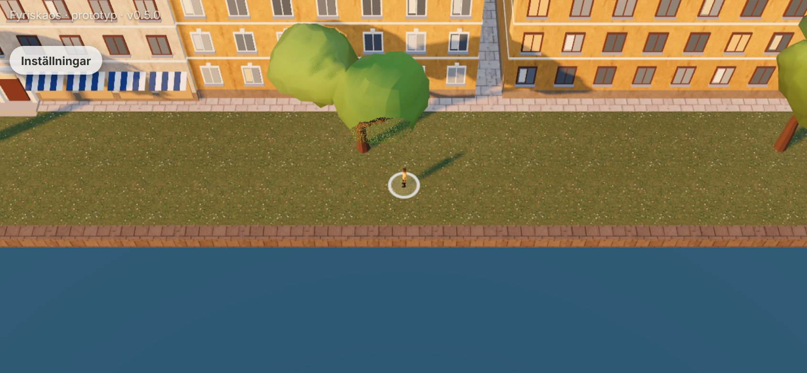
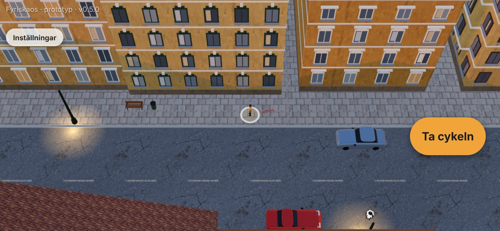

# Spelet i 3D (F-042, D-048) – skärmdumpar och mätningar

Tagna 2026-11-19 i en molnwebbläsare (Chromium) i mobilstorlek liggande (844 × 390, 2× upplösning), kvalitet auto. Spelet: https://badbagel47.github.io/fyriskaos/

| Läge | Bild |
| --- | --- |
| Gå på trottoaren vid starten |  |
| Cykla (CC0-cykel och spelaren i sittande pose) |  |
| Köra bil i cirka 60 km/h (kameran zoomar ut) |  |
| Parken med CC0-träd; trädet över spelaren blir genomskinligt |  |
| Vid ån |  |
| Kväll (`?kvall`): lyktsken och tända fönster |  |

## Prestanda

Molnet har inget grafikkort och ritar 3D i processorn, så fps där säger inget om en telefon. Måttet är spelets egen arbetstid per bild (simulering och ritning) med strypt processor. Körningen: bilen kör i 90 km/h längs den långa gatan genom staden i 40 s.

| Strypning | Kvalitet | Median | 9 av 10 under | Anrop | Trianglar |
| --- | --- | --- | --- | --- | --- |
| 4× | Medel | 10,9 ms | 17,6 ms | 137 | 169 000 |
| 4× | Hög | 9,6 ms | 17,0 ms | 131 | 169 000 |
| 6× | Medel | 15,9 ms | 25,2 ms | 137 | 168 000 |

- 60 bilder per sekund ger 16,7 ms per bild. Med 4× strypning ligger medianen långt under det, och 9 av 10 bilder ungefär vid gränsen.
- Start till första bild på långsamt nät (1,6 Mbit/s, 150 ms fördröjning) med 4× strypning: cirka 8 s; cirka 250 kB hämtas före första bilden. Modellerna (cirka 750 kB) hämtas efter första bilden. Utan strypning visas första bilden efter cirka 2 s.
- Hela staden: 63 markbitar, cirka 970 000 trianglar totalt; bara det som syns ritas.
