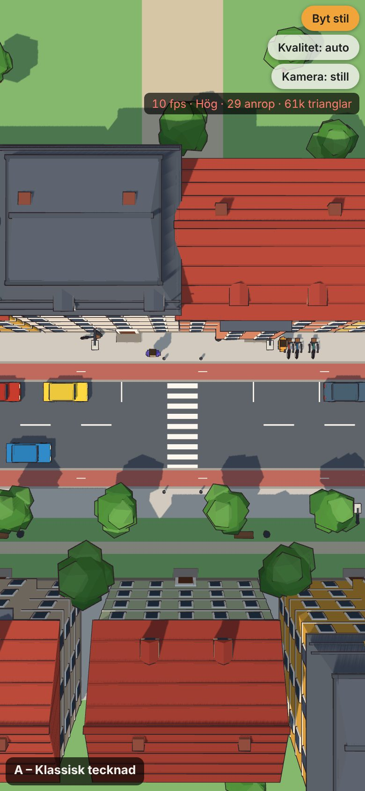
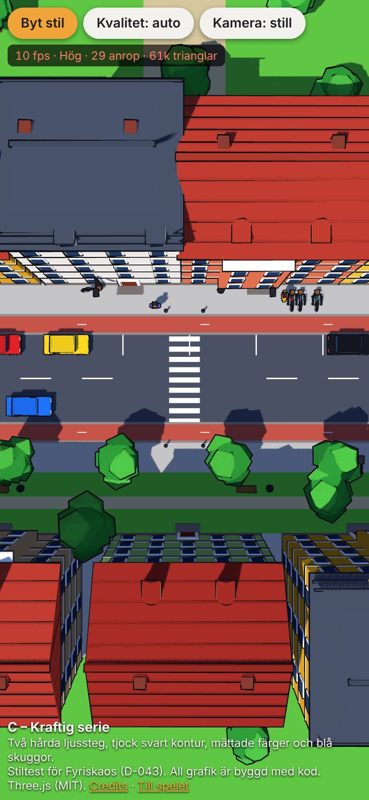
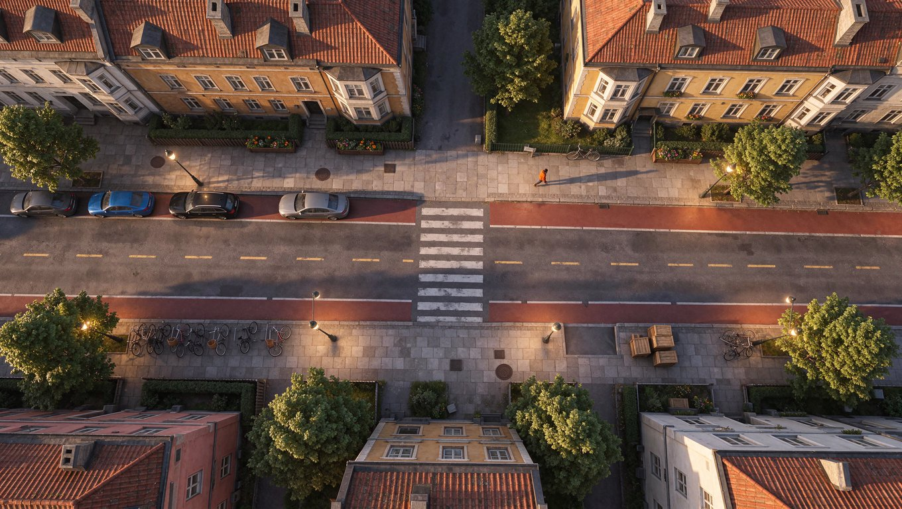
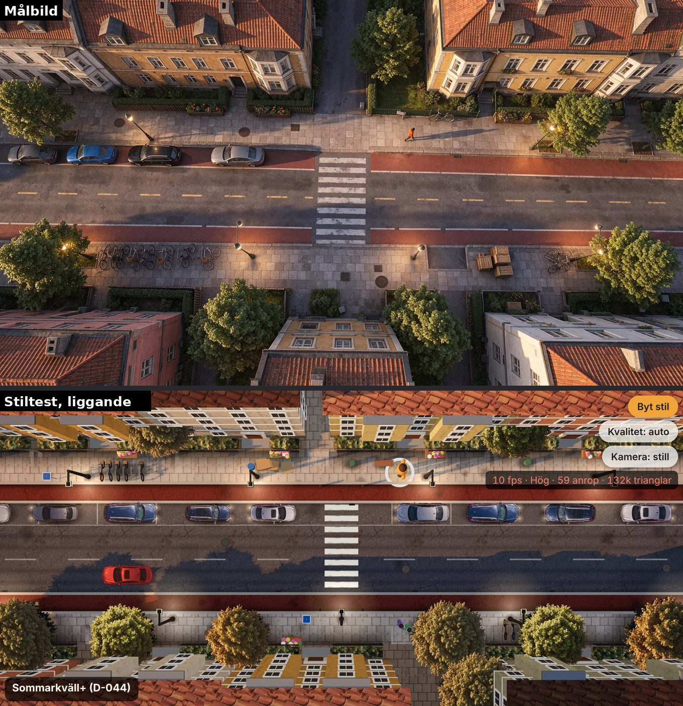
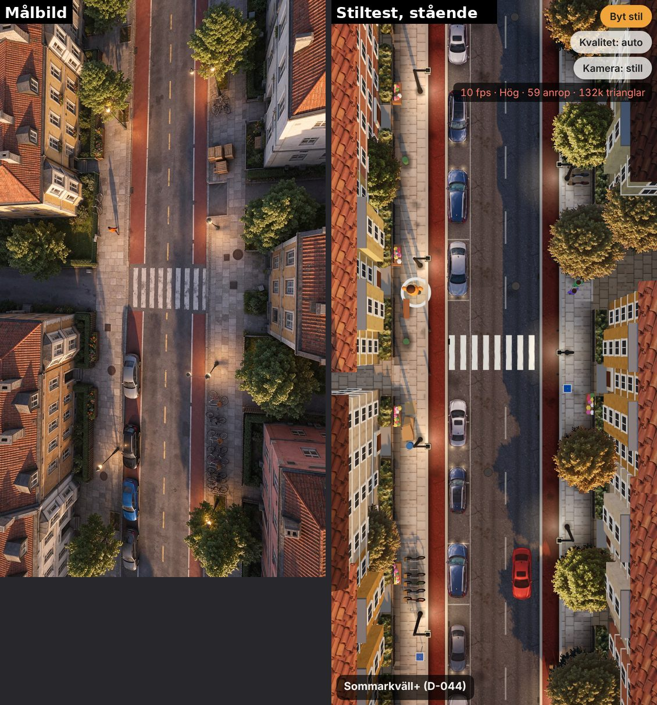

# Stiltest (D-043) – skärmdumpar och mätningar

Tagna 2026-11-18 i en molnwebbläsare (Chromium) i mobilstorlek, 2× upplösning, kvalitet Hög, stillastående kamera, efter den oberoende granskningens rättningar. Granskaren rekommenderade variant A. Testsidan: https://badbagel47.github.io/fyriskaos/stiltest.html

## A – Klassisk tecknad

## B – Mjuk pastell

## C – Kraftig serie

## Prestanda (ungefärligt test i molnet)

Molnwebbläsaren har inget grafikkort och ritar 3D i processorn, så bilder per sekund där (10–20) säger inget om en telefon. Det som går att mäta är hur mycket processortid varje bild tar i spelets egen kod och hur snabbt sidan startar. Strypning: processorn 4 respektive 6 gånger långsammare, nätet 1,6 Mbit/s med 150 ms fördröjning.

| Strypning | Kvalitet | Start till första bild | Processortid per bild (median / 9 av 10 under) | Anrop | Trianglar |
| --- | --- | --- | --- | --- | --- |
| ingen | Låg | 0,6 s | 0,4 / 0,8 ms | 21 | 41 000 |
| ingen | Hög | 1,7 s | 0,9 / 3,7 ms | 31 | 61 000 |
| 4× + långsamt nät | Låg | 4,3 s | 2,1 / 4,1 ms | 21 | 41 000 |
| 4× + långsamt nät | Medel | 5,1 s | 3,8 / 8,3 ms | 31 | 61 000 |
| 6× + långsamt nät | Hög | 6,1 s | 7,3 / 12,8 ms | 31 | 61 000 |
| 6× + långsamt nät | Auto (valde Låg) | 5,5 s | 3,9 / 9,3 ms | 21 | 41 000 |

- Hela sidan är ett paket på cirka 145 kB komprimerat; inga modellfiler laddas.
- 60 bilder per sekund ger 16,7 ms per bild. Processortiden ligger under det även med 6× strypning; hur grafikkortet i en riktig telefon klarar det får ägarens test visa (fps-mätaren på testsidan).
- Auto-läget gick ner till Låg i molnet, som det ska när bilderna per sekund är låga.

# Grafik steg 2 (D-044) – mot målbilden

Målbilder (genererade med ElevenLabs bildgenerator, samma kvarter i spelets vinkel, kvällsljus):

Stiltestet i läget Sommarkväll+ (skärmdumpar 2026-11-18, mobilstorlek, kvalitet Hög):

## Oberoende granskares poäng (1–10 mot målbilden)

| Omgång | 2 Kamera och skala | 3 Ytor | 4 Ljus | 5 Träd och bilar | 6 Småsaker |
| --- | --- | --- | --- | --- | --- |
| 1 (första versionen) | 5 | 4 | 3 | 3 | 4 |
| 2 | 7 | 5 | 5 | 4 | 6 |
| 3 | 8 | 6 | 6 | 4 | 6 |
| 4 (genererade bilar och trädkronor) | 7 | 6 | 6,5 | 7 | 5 |
| 5 (sista) | 7 | 6 | 6 | 6 | 5 |

Varje omgång bedömdes av en ny granskare, så poängen varierar något mellan omgångarna. Inget delmål nådde stabilt 8; se `docs/HANDOFF.md` för vad som hindrar.

## Prestanda (samma test som D-043)

| Strypning | Kvalitet | Start | Processortid per bild (median / 9 av 10 under) | Anrop | Trianglar |
| --- | --- | --- | --- | --- | --- |
| ingen | Låg | 3,3 s | 1,5 / 8,3 ms | 35 | 67 000 |
| ingen | Medel | 4,9 s | 2,6 / 7,5 ms | 55 | 132 000 |
| 4× + långsamt nät | Medel | 14,3 s | 6,3 / 23 ms | 55 | 132 000 |
| 6× + långsamt nät | Låg | 13,2 s | 9,6 / 20 ms | 35 | 67 000 |
| 6× + långsamt nät | Auto (valde Medel) | 14,9 s | 11,7 / 28 ms | 55 | 132 000 |

- Nedladdning: koden cirka 165 kB komprimerad plus bilder cirka 690 kB, alltså ungefär fyra gånger D-043. Starten på långsamt mobilnät tog 13–15 s mot 4–6 s förut.
- Läget Hög har långa toppar i molnet (skuggor med mjuka kanter räknas i processorn där); på en telefon med grafikkort får fps-mätaren visa.
