# Stiltest (D-043) – skärmdumpar och mätningar

Tagna 2026-11-18 i en molnwebbläsare (Chromium) i mobilstorlek, 2× upplösning, kvalitet Hög, stillastående kamera, efter den oberoende granskningens rättningar. Granskaren rekommenderade variant A. Testsidan: https://badbagel47.github.io/fyriskaos/stiltest.html

## A – Klassisk tecknad

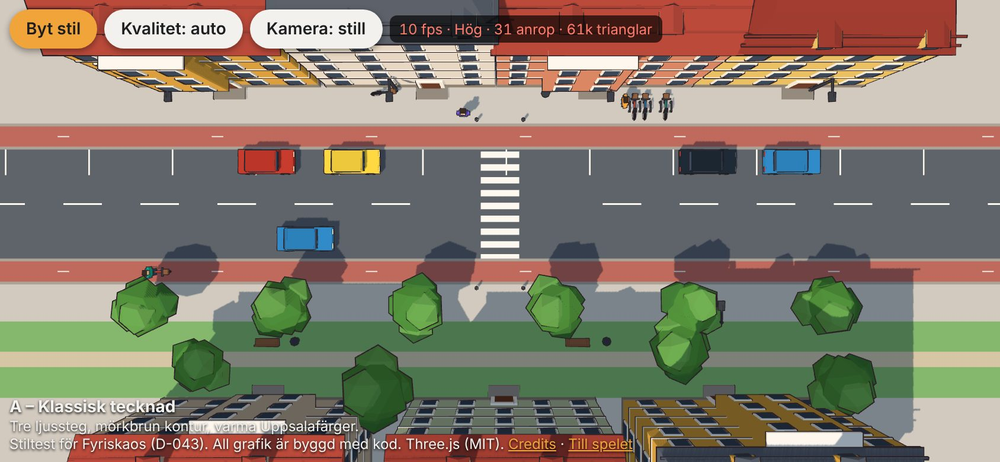

## B – Mjuk pastell

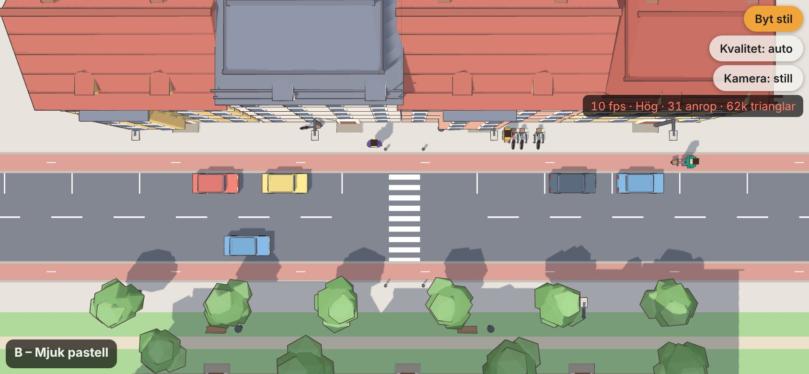
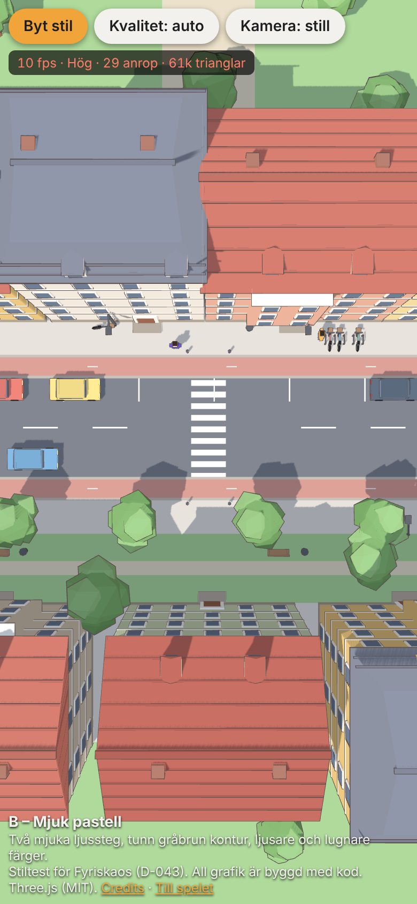

## C – Kraftig serie

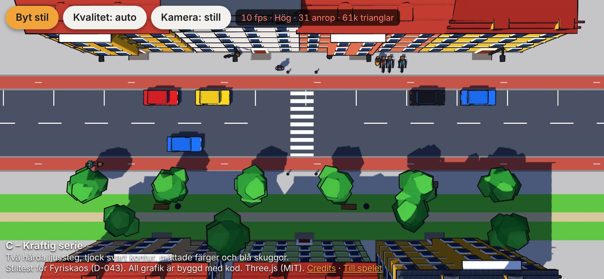

## Prestanda (ungefärligt test i molnet)

Molnwebbläsaren har inget grafikkort och ritar 3D i processorn, så bilder per sekund där (10–20) säger inget om en telefon. Det som går att mäta är hur mycket processortid varje bild tar i spelets egen kod och hur snabbt sidan startar. Strypning: processorn 4 respektive 6 gånger långsammare, nätet 1,6 Mbit/s med 150 ms fördröjning.

| Strypning | Kvalitet | Start till första bild | Processortid per bild (median / 9 av 10 under) | Anrop | Trianglar |
| --- | --- | --- | --- | --- | --- |
| ingen | Låg | 0,6 s | 0,4 / 0,8 ms | 21 | 41 000 |
| ingen | Hög | 1,7 s | 0,9 / 3,7 ms | 31 | 61 000 |
| 4× + långsamt nät | Låg | 4,3 s | 2,1 / 4,1 ms | 21 | 41 000 |
| 4× + långsamt nät | Medel | 5,1 s | 3,8 / 8,3 ms | 31 | 61 000 |
| 6× + långsamt nät | Hög | 6,1 s | 7,3 / 12,8 ms | 31 | 61 000 |
| 6× + långsamt nät | Auto (valde Låg) | 5,5 s | 3,9 / 9,3 ms | 21 | 41 000 |

- Hela sidan är ett paket på cirka 145 kB komprimerat; inga modellfiler laddas.
- 60 bilder per sekund ger 16,7 ms per bild. Processortiden ligger under det även med 6× strypning; hur grafikkortet i en riktig telefon klarar det får ägarens test visa (fps-mätaren på testsidan).
- Auto-läget gick ner till Låg i molnet, som det ska när bilderna per sekund är låga.

# Grafik steg 2 (D-044) – mot målbilden

Målbilder (genererade med ElevenLabs bildgenerator, samma kvarter i spelets vinkel, kvällsljus):

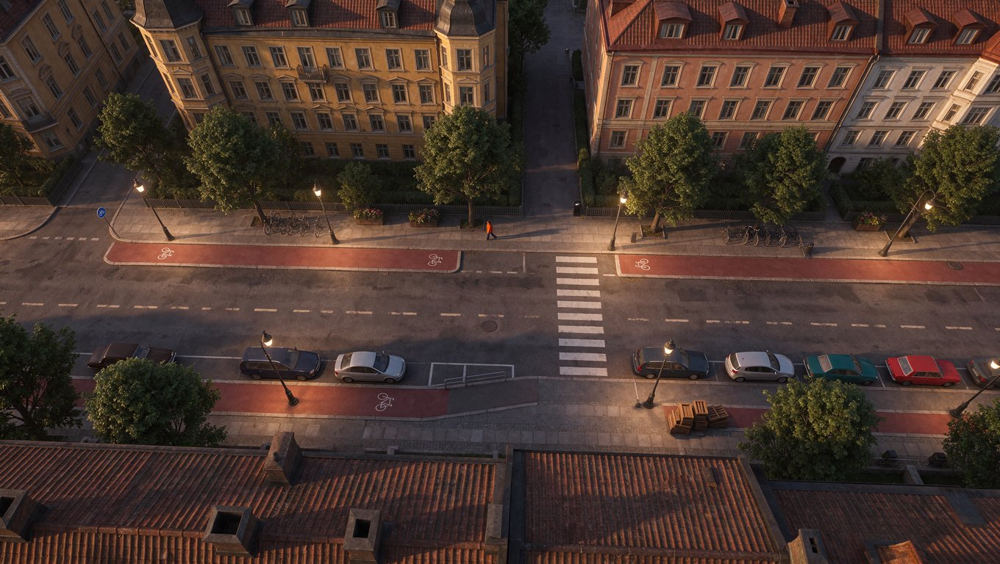

Stiltestet i läget Sommarkväll+ (skärmdumpar 2026-11-18, mobilstorlek, kvalitet Hög):

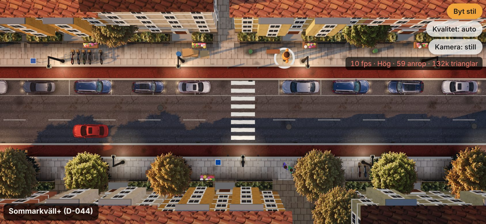
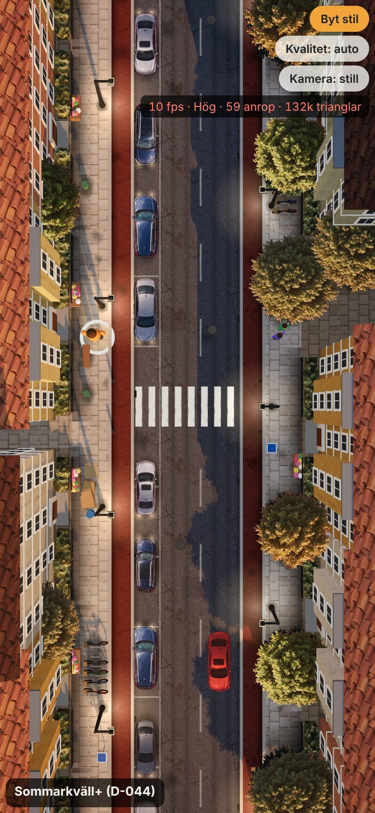

## Oberoende granskares poäng (1–10 mot målbilden)

| Omgång | 2 Kamera och skala | 3 Ytor | 4 Ljus | 5 Träd och bilar | 6 Småsaker |
| --- | --- | --- | --- | --- | --- |
| 1 (första versionen) | 5 | 4 | 3 | 3 | 4 |
| 2 | 7 | 5 | 5 | 4 | 6 |
| 3 | 8 | 6 | 6 | 4 | 6 |
| 4 (genererade bilar och trädkronor) | 7 | 6 | 6,5 | 7 | 5 |
| 5 (sista) | 7 | 6 | 6 | 6 | 5 |

Varje omgång bedömdes av en ny granskare, så poängen varierar något mellan omgångarna. Inget delmål nådde stabilt 8; se `docs/HANDOFF.md` för vad som hindrar.

## Prestanda (samma test som D-043)

| Strypning | Kvalitet | Start | Processortid per bild (median / 9 av 10 under) | Anrop | Trianglar |
| --- | --- | --- | --- | --- | --- |
| ingen | Låg | 3,3 s | 1,5 / 8,3 ms | 35 | 67 000 |
| ingen | Medel | 4,9 s | 2,6 / 7,5 ms | 55 | 132 000 |
| 4× + långsamt nät | Medel | 14,3 s | 6,3 / 23 ms | 55 | 132 000 |
| 6× + långsamt nät | Låg | 13,2 s | 9,6 / 20 ms | 35 | 67 000 |
| 6× + långsamt nät | Auto (valde Medel) | 14,9 s | 11,7 / 28 ms | 55 | 132 000 |

- Nedladdning: koden cirka 165 kB komprimerad plus bilder cirka 690 kB, alltså ungefär fyra gånger D-043. Starten på långsamt mobilnät tog 13–15 s mot 4–6 s förut.
- Läget Hög har långa toppar i molnet (skuggor med mjuka kanter räknas i processorn där); på en telefon med grafikkort får fps-mätaren visa.

# Grafik steg 3 (D-045) – lutad kamera

Nya målbilder i den lutade vinkeln, i stil med ett påkostat mobilspel (genererade med ElevenLabs bildgenerator):

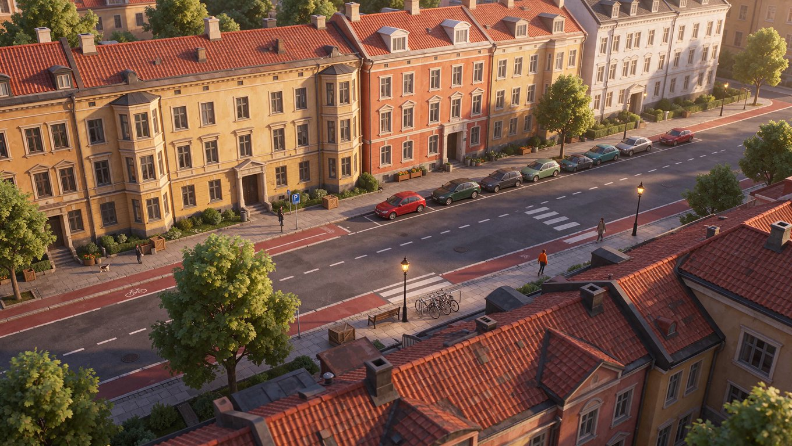
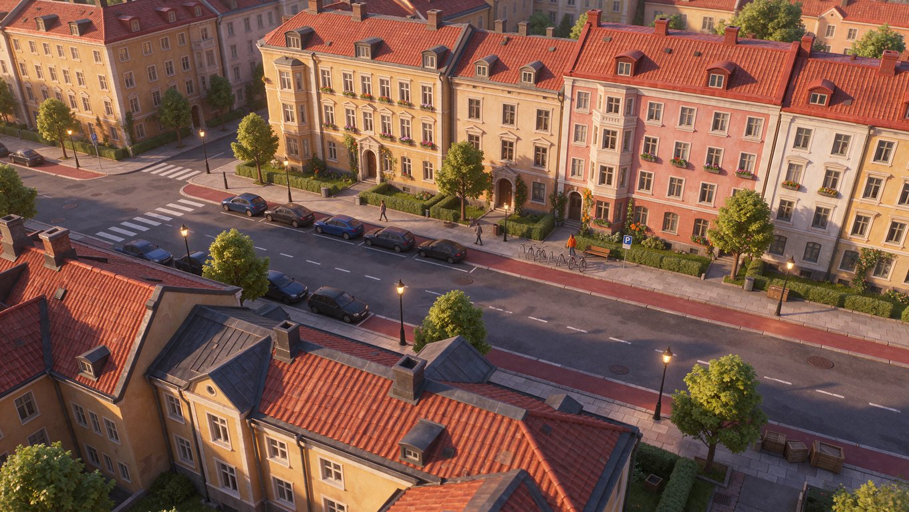

Stiltestet, båda kameravinklarna (skärmdumpar 2026-11-19, mobilstorlek, kvalitet Hög):

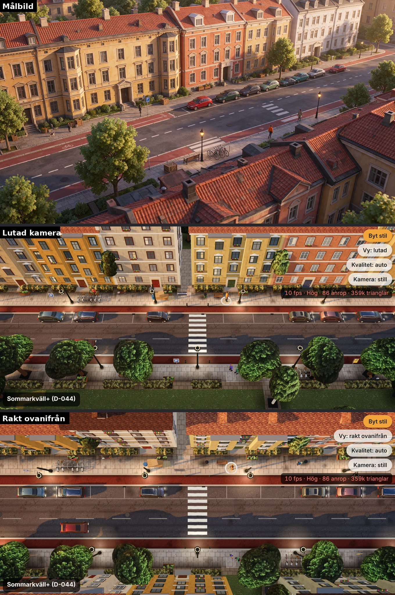
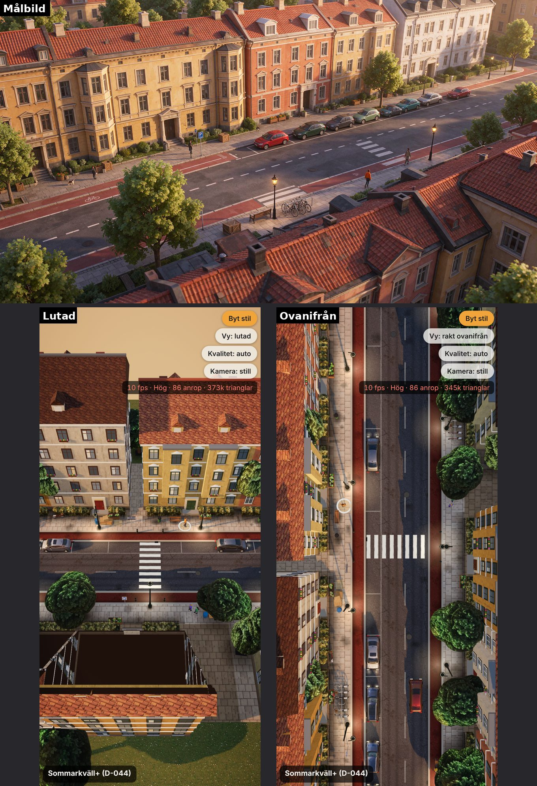
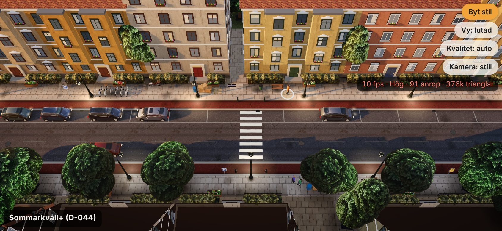

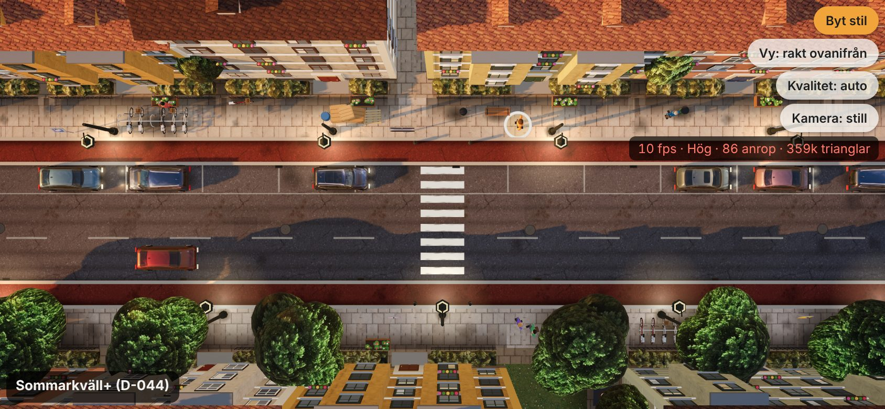
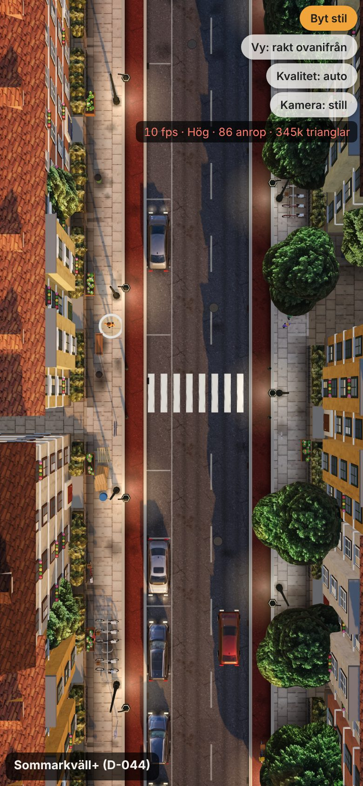

## Poäng med fasta kriterier (`kriterier.md`, samma instruktion varje omgång)

| Omgång | 1 Kamera och läsbarhet | 2 Jämn detaljnivå | 3 Träd | 4 Tak och fasader | 5 Ytor och ljus |
| --- | --- | --- | --- | --- | --- |
| 1 | 5 | 4 | 4 | 5 | 6 |
| 2 | 6 | 5 | 6 | 5 | 6 |
| 3 (sista) | 7 | 5 | 6 | 5 | 7 |

Målet minst 8 på allt nåddes inte. Se `docs/HANDOFF.md` för vad som återstår. Bilderna ovan är från steg 3; steg 4 längre ner.

## Prestanda (samma långsamma test: 1,6 Mbit/s, 150 ms fördröjning)

| Processor | Första bilden | Alla fullstora bilder | Processortid per bild (median) | Anrop | Trianglar |
| --- | --- | --- | --- | --- | --- |
| normal | 2,7 s | 9,5 s | 2,8 ms | 85 | 357 000 |
| 4× långsammare | 4,1 s | 12,6 s | 29 ms | 85 | 357 000 |
| 6× långsammare | 5,1 s | 13,8 s | 45 ms | 85 | 357 000 |

- Start under 6 s: uppnått (4,1–5,1 s). Scenen visas med små förhandsbilder och de fullstora bilderna laddas efteråt; alla bilder är WebP.
- Nedladdning: koden 171 kB komprimerad, bilderna 426 kB (förra steget 690 kB).
- Processortiden per bild har ökat (träden, personerna och prylarna har många fler trianglar). Med strypt processor ligger den över 17 ms, alltså under 60 bilder per sekund på en svag telefon. Det behöver bantas innan stilen förs in i spelet.

# Grafik steg 4 (D-047) – prestanda, träd, hus och ljus

Samma målbilder som steg 3. Skärmdumpar 2026-11-19, mobilstorlek, kvalitet Hög, lutad kamera som förval. Bilderna är tagna om efter B-050 (kameran längre bort med smalare bildvinkel, så husen lutar mindre vid kanterna):

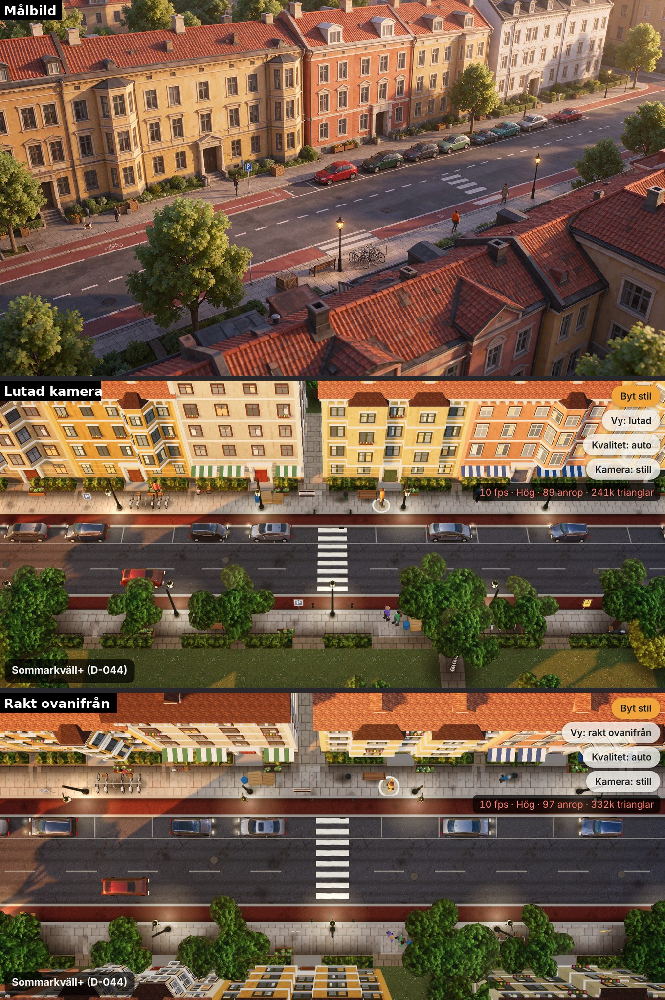
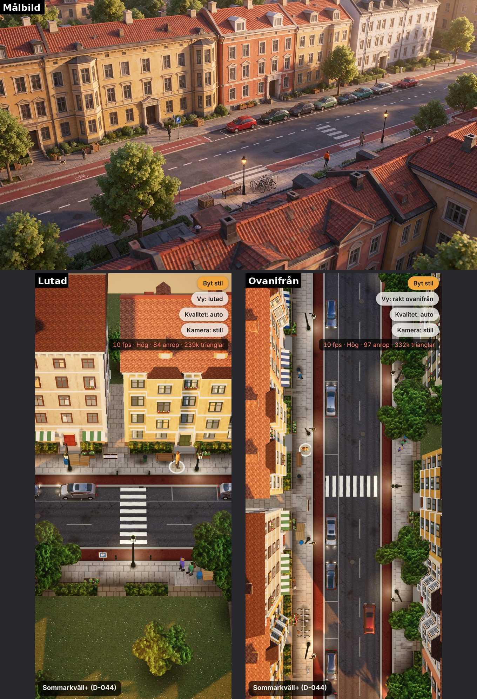
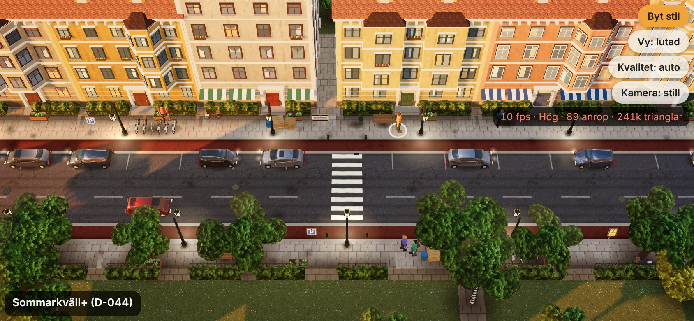
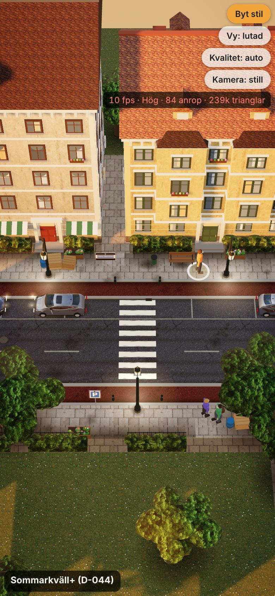
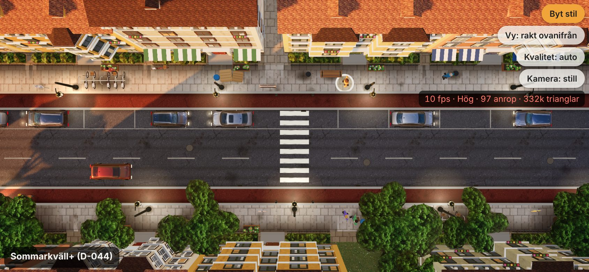
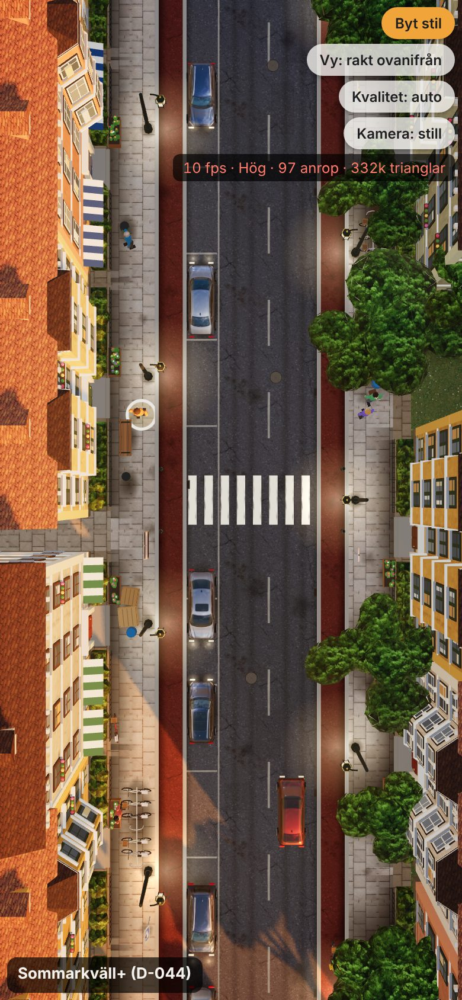

Ändrat: lättare prylar och personer (färre trianglar), träd byggda med stam, grenar och lövklungor som skuggas som en mjuk krona, gröna täta häckar, klassiska lyktor, kantiga burspråk med plåttak och olika upplägg per hus, fyra fönstertyper (parfönster, rundbågar, höga, tvåluftsfönster) med olika överstycken, några tända fönster, butiker med markiser, portar med pilastrar och trappsteg, mindre takpannor, lägre och mer gyllene kvällssol från sydväst och ljusare fyllnadsljus.

## Poäng med fasta kriterier (samma instruktion som steg 3)

| Omgång | 1 Kamera och läsbarhet | 2 Jämn detaljnivå | 3 Träd | 4 Tak och fasader | 5 Ytor och ljus |
| --- | --- | --- | --- | --- | --- |
| 1 | 7 | 6 | 5 | 5 | 6 |
| 2 | 7 | 5 | 5 | 6 | 6 |
| 3 (sista) | 7 | 5 | 5 | 6 | 6 |

Målet minst 8 nåddes inte. Det som drar ner enligt granskarna: personer och cyklar är för enkla mot bilarna (2), trädkronorna läses som klumpar och alla träd liknar varandra (3), fönstren upprepas fortfarande våning för våning (4), och cykelbanor och gräs är släta (5).

## Prestanda (processortid per bild, när allt har laddats)

Mätt med 4× strypt processor efter att alla bilder laddats: 3 s väntan, sedan 20 s mätning. Samma mätning gjordes på steg 3 som jämförelse.

| Version | Strypning | Kvalitet | Median | 9 av 10 under | Anrop | Trianglar |
| --- | --- | --- | --- | --- | --- | --- |
| Steg 3 | 4× | Medel | 7,0 ms | 16,3 ms | 85 | 357 000 |
| Steg 3 | 4× | Hög | 9,5 ms | 13,4 ms | 85 | 357 000 |
| Steg 4 | 4× | Låg | 4,3 ms | 8,1 ms | 53 | 140 000 |
| Steg 4 | 4× | Medel | 6,2 ms | 18,8 ms | 89 | 241 000 |
| Steg 4 | 4× | Hög | 6,5 ms | 11,6 ms | 88 | 240 000 |
| Steg 4 | 6× | Medel | 13,3 ms | 30 ms | 89 | 241 000 |

- Under 17 ms med 4× strypning: uppnått (median 4–7 ms). Trianglarna minskade med cirka en tredjedel.
- Siffrorna 29–45 ms i steg 3 mättes medan de fullstora bilderna laddades in och visar själva laddningen, inte vanlig körning. Under laddningen ligger det fortfarande kring 29 ms (4×).
- Start till första bild på långsamt nät med 4× strypning: 4,4 s; alla fullstora bilder efter 12 s.
